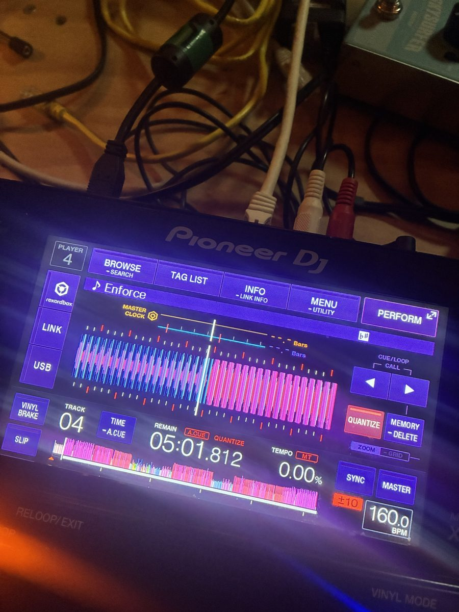
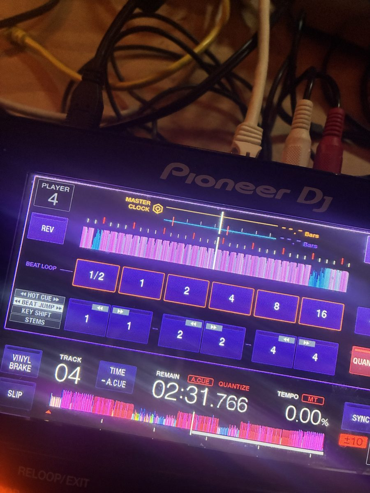
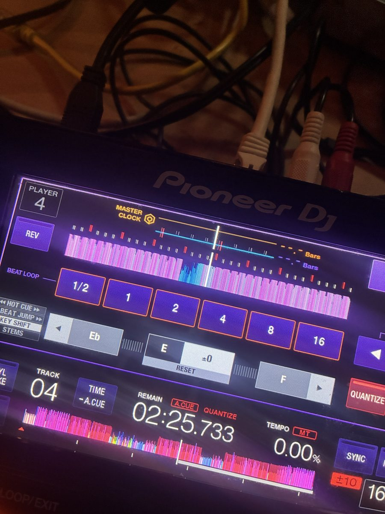
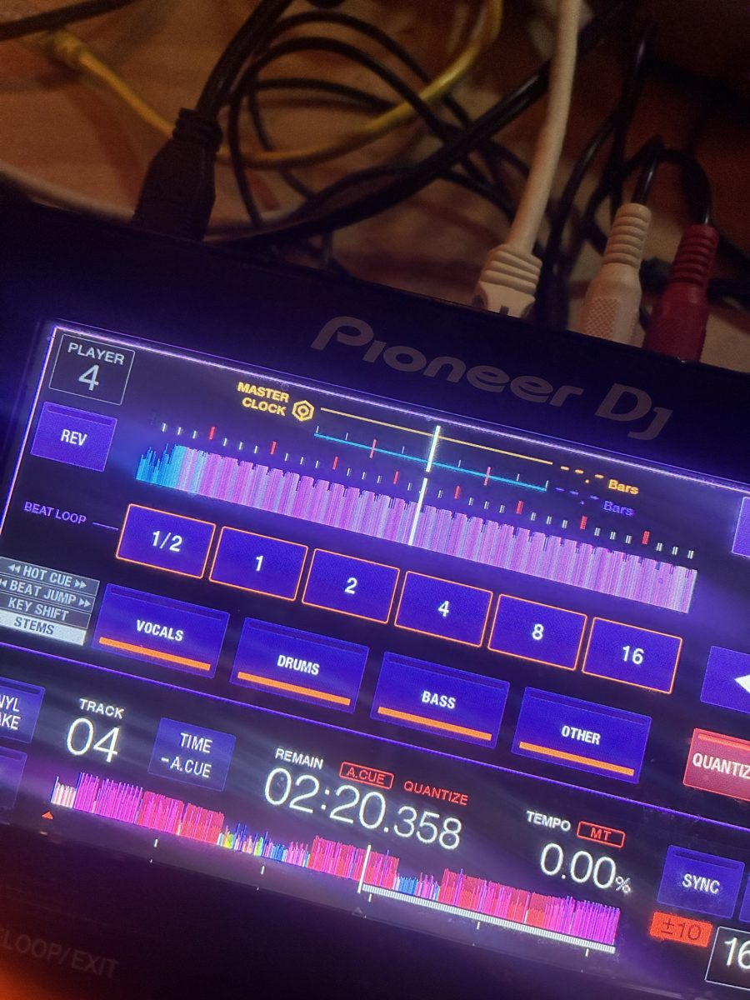
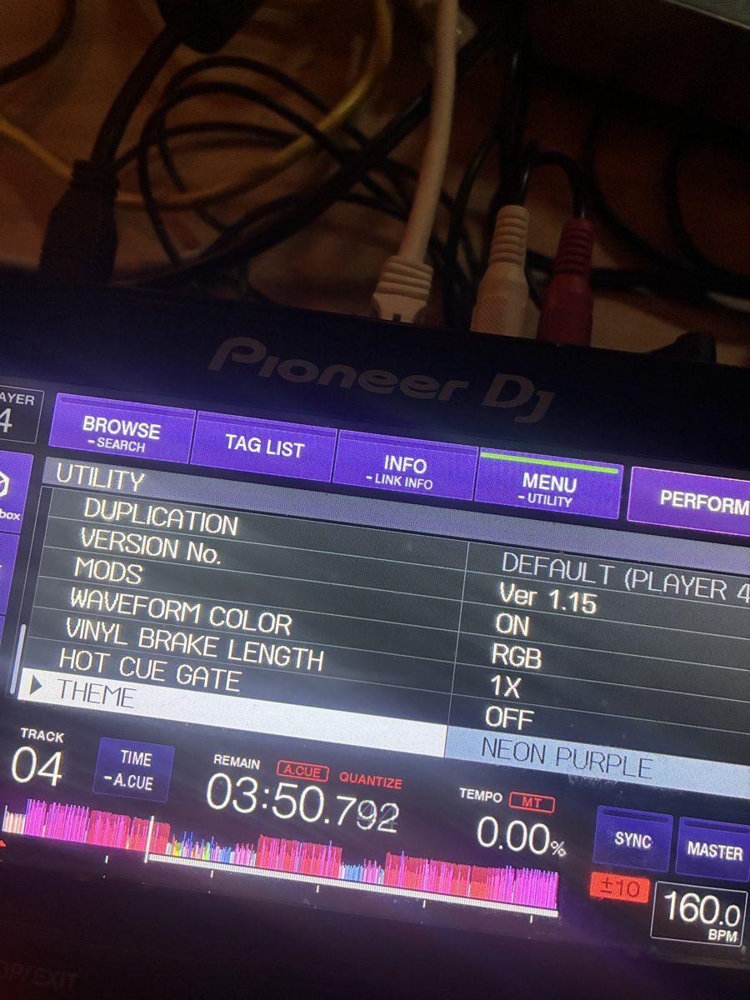

# XDJ Mod Studio: XDJ-700 Mods

Open-source mods for the **XDJ-700** (firmware 1.15): RGB and 3-band
waveforms, live key shift, stems, beat jump pads, live colour themes and
more. Fully open source (MIT). There's also a Mac and Windows app,
**Mod Studio**, which prepares your tracks, designs themes, runs your deck's
firmware in a built-in emulator and installs the mods.

**Nothing is ever flashed.** Mods are loaded into the deck's working memory
over USB through the deck's own service connection. Switch the deck off and
on and it is completely stock again.

> Independent community project, not affiliated with, endorsed by or
> supported by Pioneer DJ / AlphaTheta. "Pioneer DJ", "XDJ", "CDJ" and
> "rekordbox" are trademarks of their owners and are used only to describe
> compatibility. Use at your own risk.

## On a real XDJ-700

Photos from a real deck running Mod Studio v0.99.5, with the NEON PURPLE
theme and RGB waveforms:

| | | |
| :---: | :---: | :---: |
|  |  |  |
| Main screen: RGB waveforms, NEON PURPLE theme | PERFORM › BEAT JUMP | PERFORM › KEY SHIFT |
|  |  | |
| PERFORM › STEMS | UTILITY: mod settings and theme | |

**v0.99.5 test status (2026-11-04).** Tested on a real XDJ-700 with an Apple
Silicon Mac: everything except **FLAC playback** and **stems**, which have
not been tried with this release yet. The **Windows** build of v0.99.5 has
not been tested yet.

## What works

**Tested on a real deck**

| Mod | Notes |
| --- | --- |
| RGB and 3-band waveforms | overview strip and centre display |
| Live key shift | PERFORM › KEY SHIFT, MASTER TEMPO on, tempo stays put |
| Live themes | pick on the deck: UTILITY › THEME; OFF restores the stock colours exactly |
| Live stems | PERFORM › STEMS mutes vocals / drums / bass / other, heard after ~30 s |
| Beat jump pads | PERFORM › BEAT JUMP, tap and swipe (1–64 beats) |
| Mod settings in UTILITY | hold MENU, end of the list: mods on/off, waveform style, vinyl brake, hot cue gate, theme (hardware-tested) |

**Working in the emulator, not yet tested on a deck.** These run against the
deck's real firmware in the emulator, so they should work on a real deck,
but nobody has tried them on one yet:

| Mod | Notes |
| --- | --- |
| Faster stem mute (beta) | rewrites the audio the deck already buffered; < 1 s in the emulator |
| Phase meter | this deck's beats; the master row needs link data |
| Vinyl brake length | UTILITY › VINYL BRAKE LENGTH, 0.5×–15× |
| 8 hot cues | pages A–C / D–F / G–H |
| FLAC and Ogg Opus playback | own decoders on the deck |

## In development (experimental, not released)

> **Work in progress.** Everything in this section is on `master` only, is
> not in any release yet, and may still change or break. Try it only if you
> are comfortable power-cycling your deck; every mod still lives in the
> deck's working memory only, so a power cycle always brings back the stock
> deck.

**USB-stick install (no cable for the mods themselves).** Mod Studio's new
**Write to USB stick** button (Mods page) puts the mods you picked into a
`PIONEER/MODS` folder on your library stick. A small loader in the deck's
memory installs them when the stick goes in. Rehearsed on a real XDJ-700 on
2026-11-04, with the loader put into RAM over the cable:

- a stick without the folder is ignored;
- a byte-exact copy test passed;
- the full pack (RGB waveforms, PERFORM pads, themes, FLAC) installed from
  the stick and the deck kept working normally.

Still missing: getting the loader onto the deck without the cable (planned
for the optional permanent update), and key shift, vinyl brake length and
the phase meter, which are cable-only for now.

**FLAC from the rekordbox library.** Tracks loaded from the rekordbox
library failed with **E-8305**. rekordbox marks FLAC files with a type the
XDJ-700's player refuses before even opening the file, so our FLAC decoder
never got a chance. A one-word change in the deck's decoder choice now sends
them to our decoder. On 2026-11-04 the first FLAC played on a real XDJ-700.
Known issues, being worked on:

- search and jog scrubbing on a FLAC are a little laggy;
- with colour waveforms, switching to or from a FLAC can leave the previous
  track's waveform on screen until you load another track (the stock blue
  waveform is not affected).

The OneLibrary converter now marks FLAC tracks the way rekordbox does.

**Also new, not yet tried on a deck:** custom waveform colours (1 to 3
colours, UTILITY › WAVEFORM COLOR › CUSTOM), lit buttons in your own colour
(saved with a theme), and 5x more audio in the emulator.

## For DJs: Mod Studio

1. Download Mod Studio from Releases.
   - **Mac** (Apple Silicon, macOS 14+): `XDJ-Mod-Studio.zip`. The first
     time, right-click the app and choose Open.
   - **Windows** (64-bit Windows 10/11, beta): `XDJ-Mod-Studio-Windows.zip`.
     Unzip it and run `XDJ Mod Studio.exe` (SmartScreen: More info → Run
     anyway). Every build is checked by CI on a clean Windows
     machine (the app starts, its pages load, the emulator engine loads).
     Running your firmware in the emulator and installing to a real deck
     from Windows have **not been tried by a person yet** (both are proven
     on a Mac). Emulator sound on Windows shipped 2026-10-24 (pygame
     mixer; the Mac uses CoreAudio) -- if it is silent for you, set
     `XDJ_DECK_SOUND=1` and please report how it goes.
2. **Add your firmware.** Get the official XDJ-700 firmware 1.15 update file
   from Pioneer DJ's support site and give it to Mod Studio when it asks.
   It checks the exact file, then builds everything it needs in about
   3 minutes. This project never distributes Pioneer's firmware.
3. Try the mods in the emulator, then connect the deck over USB and click
   **Install**. Power-cycle the deck any time to go back to stock.

## For DJs: OneLibrary USB sticks made readable for the XDJ-700

The XDJ-700 only reads the old Device Library (`PIONEER/rekordbox/export.pdb`).
Sticks written by newer software — djay, Traktor (via the public OneLibrary
SDK) or recent rekordbox versions — carry the encrypted SQLite file
`PIONEER/rekordbox/exportLibrary.db` instead, which the deck ignores.

The bundled converter turns that OneLibrary database into the file the deck
reads (tracks, artists, albums, genres, labels, keys, colours, playlists with
folder tree + entries, browse columns and artwork paths — analysis data and
hot cues are not part of it; the deck will analyse on first play):

```bash
# Python 3.10+ with wheels available for macOS (incl. Apple Silicon) and Windows
python3 -m pip install sqlcipher3-wheels
python3 tools/onelibrary_to_pdb.py /Volumes/YOUR_STICK      # or any stick folder
```

It writes `PIONEER/rekordbox/export.pdb` next to `exportLibrary.db` and backs
up any export.pdb already there. It never modifies the original files. Pass
`--dry-run` to see what it would write, and run the test suite (add your own
stick with `ONELIBRARY_TEST_STICK=...`):

```bash
python3 tools/onelibrary_to_pdb_test.py
```

Fields the converter cannot fill (documented in detail in
[tools/onelibrary_to_pdb.py](tools/onelibrary_to_pdb.py), `_FIELDS_DOC`):
play count (the OneLibrary database resets `djPlayCount` to 0 while
rekordbox's own export keeps old counts), hot-cue/loop data, and a few
per-track id rows that rekordbox renumbers into historically freed slots on
its own re-exports (irrelevant to the deck — the link targets are the same).
`export.pdb` is the first open-source writer of this format ever, built from
crate-digger's documentation and verified table-by-table against real
rekordbox exports.

## For developers

```bash
python3 -m venv .venv && .venv/bin/pip install numpy pillow capstone hidapi pygame
sh tools/build_tic6x_objdump.sh      # TI C6x disassembler for the audio-chip emulator (once, ~10 min)
.venv/bin/python -m emu.fwhome setup /path/to/XDJ700_v1.15.UPD --dev
```

The firmware setup boots the deck twice (plain, then with the real audio
chip) and needs `work/tic6x/objdump` from the step above; the packaged
app ships it. `XDJ_TIC6X_OBJDUMP=/path/to/objdump` points at another copy.
The OneLibrary converter test also needs `pip install sqlcipher3-wheels`.

`--dev` also places the generated files at the paths the research tools
expect (`work/`, `cache/`, `studio/assets/`, `tools/data/`, all git-ignored).
Run Mod Studio from source with `.venv/bin/python -m studio.app`.

Deck code is written in SH-4 assembly (`tools/shasm.py`) or C built with a
local `sh-elf-gcc` (`tools/build_sh_gcc.sh`). Every mod has an emulator test
that must pass before it touches hardware, for example:

```bash
.venv/bin/python tools/perform_pads.py emu
.venv/bin/python tools/hotcue8_test.py
.venv/bin/python tools/theme_switch.py check
.venv/bin/python tools/sh4test.py
```

Build the Mac app with `PUBLIC=1 sh tools/build_studio.sh` (result:
`dist/public/XDJ Mod Studio.app`; the user brings the firmware on first
run). Without `PUBLIC=1` it is the private tester build, which bakes in
`studio/assets/` and `emu/assets/` from a `--dev` firmware setup. With the
SH compiler in `work/sh-tools` every deck module is rebuilt from source;
modules whose other inputs are missing here (the FLAC-only decoder needs
`work/drflac`, key shift needs the C6x compiler `work/tic6x-tools`) ship
their committed `prebuilt/deck/` copies instead. Install it with
`ditto --noextattr --norsrc` (Finder metadata on Desktop files fails the
strict signature check), and never write files into the installed bundle:
that breaks its signature.

### Layout

| Path | What |
| --- | --- |
| `emu/` | SH7724 emulator (C core + Python devices), deck UI, firmware home |
| `emu/c6x/` | TI C674x DSP emulator (work in progress) |
| `tools/` | mods, deck installers (`*_apply.py`), emulator tests, RE tools |
| `studio/` | Mod Studio (local web UI + server) |
| `mods/themes.py` | theme presets |
| `site/` | project website (GitHub Pages) |
| `docs/`, `*.md` | reverse-engineering notes (formats, protocols, addresses) |

### Safety rules (enforced by every deck tool)

- Writes only inside the deck's RAM window; the firmware-erase command never
  appears in any tool.
- Every byte is checked before it changes and read back after; anything
  unexpected stops the install.
- A read-only survey proves a mod's memory is empty on *your* deck first.
- Emulator before hardware, always.

## Firmware and copyright

No firmware, decoded firmware, emulator snapshots, screenshots of the
deck's screen or artwork lifted from it are in this repository. They are
all rebuilt on your own Mac from your own official update file
(`emu/fwhome.py`); see [SOURCES.md](SOURCES.md).

## Licence

MIT for the code in this repository (see [LICENSE](LICENSE)). It grants
nothing for Pioneer DJ / AlphaTheta firmware.
